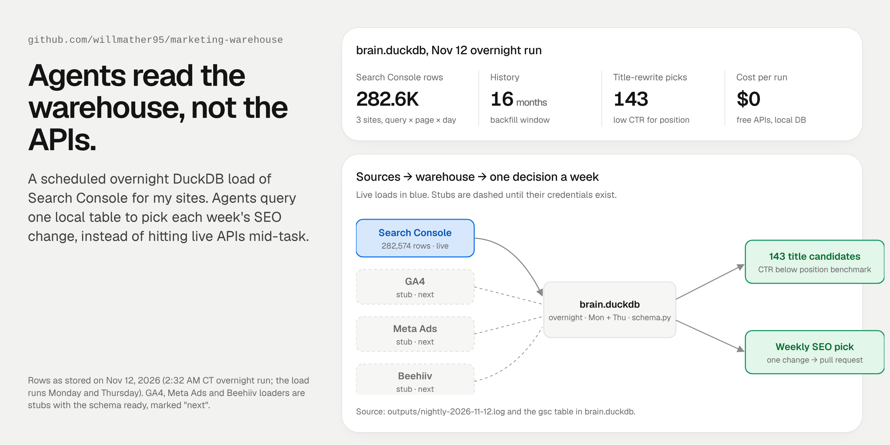

# marketing-warehouse



A scheduled overnight DuckDB load of Google Search Console for my own sites (it runs Monday and Thursday). My AI agents query one local table to pick each week's SEO change, so they don't hit live APIs in the middle of a task, burn quota, or quote different numbers.

**What's live and what isn't:** the Search Console loader runs on that schedule in production. GA4, Meta Ads and Beehiiv loaders are **stubs**. Each run calls them and they print one line, with their tables designed and their credentials listed. They're next, not done.

## What it does

| | |
|---|---|
| **Loads** | Search Console `date × page × query` (clicks, impressions, CTR, position) for every site in `sites.json`. The first run backfills 16 months. Each run after that re-pulls only the last 3 days, because GSC revises recent data. |
| **Stores** | One DuckDB file: `gsc_page_query` and `gsc_load_meta` (range and row count per site). There's no server and nothing to host. |
| **Decides** | `title_candidates.py` flags pages ranking 1–10 whose CTR is below the position benchmark. Those are the cheapest wins: a better title, not a new page. |
| **Checks itself** | `check_freshness.py` fails if any site is more than 4 days stale or its row count drops. |

## How it works

```
Search Console API ──► gsc_load.py ──► brain.duckdb ──► title_candidates.py ──► weekly pick ──► 1 pull request
   (read-only SA)      incremental        one file         CTR below benchmark     agent drafts      owner approves
GA4 · Meta · Beehiiv ─ stubs (next) ─┘
```

- **Read-only credentials.** The loader uses a service account with `webmasters.readonly`, read from `GSC_KEY_FILE`. It refuses a key file that isn't mode 600 and never prints it.
- **Idempotent.** Each chunk deletes its date range, then inserts it, so reruns never double count (tested).
- **Paged and polite.** It requests 25,000 rows a page, in month-sized windows, with backoff on 429 and 5xx errors.

## Results (my sites, Nov 12, 2026 overnight run)

| | |
|---|---|
| Search Console rows stored | **282,574** across 3 sites (281,606 on the largest) |
| History | **16 months** |
| Title-rewrite candidates this week | **143** |
| Cost per run | **$0** (free APIs, a local file) |

The weekly SEO loop in [seo-pack](https://github.com/willmather95/seo-pack) can read its Search Console data from here. On the largest site, average Google position went from 20.5 to 14.4 over two confirmed 28-day windows.

## Run it

```bash
pip install duckdb
python demo/make_demo.py                 # made-up site, 2,400 rows, picks 3 weak pages
python -m unittest discover tests        # interpolation, windows, picks, idempotent reload
duckdb demo/out/brain.duckdb < queries/examples.sql
```

Live, with your own sites:

```bash
pip install -r requirements.txt
cp sites.example.json sites.json         # your exact GSC property strings
export GSC_KEY_FILE=~/keys/gsc-reader.json   # mode 600, outside the repo
python loaders/gsc_load.py --full        # first 16-month backfill
python loaders/run_nightly.py --candidates-brand tool
python loaders/check_freshness.py
```

## Layout

```
loaders/   config, schema, gsc_load (live), title_candidates, check_freshness, run_nightly,
           ga4_load · meta_ads_load · beehiiv_load (stubs)
demo/      made-up data generator
queries/   SQL agents actually ask
tests/     offline unit tests
```

MIT license.
